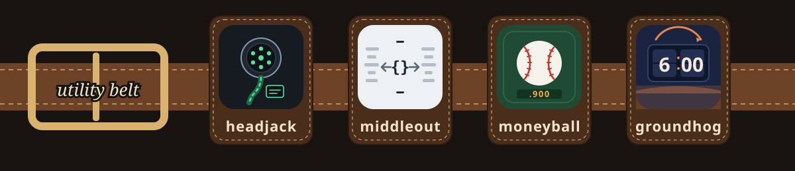

<p align="center"></p>

Four tools that make coding agents cheaper and more reliable. Each one does one job, installs on its own, and measures itself, so you can tell whether it is earning its place. They share one idea: **guarantee steps with hooks instead of longer prompts.** A hook costs nothing until the moment it applies, and then it fires every time.

<table>
<tr>
<td width="50%" valign="top">
<a href="packages/headjack"></a>
<h3><a href="packages/headjack">headjack</a></h3>
<b>Skills, loaded the moment you need them.</b> An indexed skill library and a per-prompt retrieval hook replace a preloaded skill listing. The right skill got loaded 67% of the time, against 33% when all skills were preloaded.
</td>
<td width="50%" valign="top">
<a href="packages/middleout"></a>
<h3><a href="packages/middleout">middleout</a></h3>
<b>API calls, compressed.</b> Agents write one small plan over their MCP servers (fan-out, nesting, pagination), and only the fields they selected reach the model. 7–28× cheaper on per-item fan-out.
</td>
</tr>
<tr>
<td width="50%" valign="top">
<a href="packages/moneyball"></a>
<h3><a href="packages/moneyball">moneyball</a></h3>
<b>Pay for the model each job needs.</b> Measures every subagent run from transcripts, graduates repeat work to cheaper models at 90% success over 10+ runs, and routes dispatches with a hook.
</td>
<td width="50%" valign="top">
<a href="packages/groundhog"></a>
<h3><a href="packages/groundhog">groundhog</a></h3>
<b>Stop re-living the same session.</b> Finds the lessons agents re-learn and the procedures they repeat by hand. Accepted lessons go in a committed ledger that hooks enforce; repeated procedures become runbooks.
</td>
</tr>
</table>

Each tool is published to its own repository ([headjack](https://github.com/grexican/headjack) · [middleout](https://github.com/grexican/middleout) · [moneyball](https://github.com/grexican/moneyball) · [groundhog](https://github.com/grexican/groundhog)), with its own README, install instructions and marketplace. This monorepo is where they are built: one shared core, one CI, one release train. Issues and pull requests come here.

## Install

Pick a tool and follow its README. Every one works the same way:

```bash
# Claude Code
claude plugin marketplace add grexican/moneyball
claude plugin install moneyball@moneyball

# any other agent: Cursor, Codex, Gemini CLI, Copilot, Windsurf
git clone https://github.com/grexican/moneyball
node moneyball/dist/install.mjs --platform cursor --project .
```

All four at once, from this repo:

```bash
claude plugin marketplace add grexican/utility-belt     # then: claude plugin install <tool>@utility-belt
node scripts/install.mjs all --platform <claude|cursor|codex|gemini|copilot|windsurf> --project <dir>
```

### No Node? Native binary

```bash
curl -fsSL https://raw.githubusercontent.com/grexican/utility-belt/main/scripts/install.sh | sh    # macOS, Linux
irm https://raw.githubusercontent.com/grexican/utility-belt/main/scripts/install.ps1 | iex         # Windows
belt install all --platform claude
```

`belt` is a single executable that runs any of the tools (`belt moneyball report`, `belt groundhog scan`). It is built per OS in CI. It has no local embeddings (those need native modules), so headjack uses keyword search in the binary.

## Platform support

| | Skills | Context injection | Block | Rewrite tool input | MCP |
|---|---|---|---|---|---|
| Claude Code | ✓ | ✓ | ✓ | ✓ | ✓ |
| Codex | ✓ | ✓ | ✓ | ✓ | ✓ |
| Gemini CLI | ✓ | ✓ | ✓ | ✓ | ✓ |
| Copilot (CLI / VS Code) | ✓ | session + post-tool only | ✓ | ✓ | ✓ |
| Cursor | ✓ | session + post-tool only | ✓ | ✓ | ✓ |
| Windsurf / Devin | ✓ | ✗ | ✓ | ✗ | user-global only |

Where an agent cannot do something, that feature turns off rather than half-working. Each tool's README lists exactly what works on each platform.

## How the monorepo works

`packages/<tool>` is canonical, in Claude Code plugin layout, and **each package folder is a complete standalone repo**: on every push to `main`, CI splits each one out to its own mirror. `npm run sync` generates everything that would otherwise drift, inside each package:

- `dist/<tool>.mjs` and `dist/install.mjs`: self-contained bundles (plugin installs ship no `node_modules`);
- `adapters/{cursor,codex,gemini}/`: native packages with hooks translated to each platform's events and output shapes;
- the package's own marketplace files, and the **Install** and **Part of the utility belt** sections of its README;
- this repo's root marketplaces and the belt banner above.

One hook handler serves every platform: `@utility-belt/core/hooks` normalizes each platform's input and writes its output shape. CI runs `npm run sync:check`, so generated files can't go stale.

```bash
npm install && npm test && npm run sync
```

```
packages/core        shared plumbing: project root, stats dotfiles, frontmatter, embeddings, transcripts, hook runtime
packages/<tool>      one tool: README, docs/ (icon, hero), bin/, src/, skills/, hooks/, adapters/, dist/, test/
scripts/             sync, install, platforms, split (mirrors), build-binary, belt, install.sh, install.ps1
```

Requirements: Node 22.13+ (built-in `node:sqlite`). Building the native binary needs Node 25.5+.
