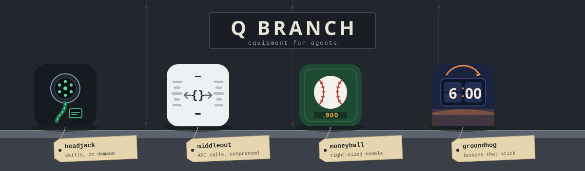
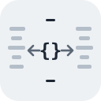

<p align="center"></p>

In the James Bond films, **Q Branch** is the workshop behind the field agents. Q and his staff invent the gadgets, test them until they work, and brief the agent on how to use each one before the mission.

This repository is that workshop for **AI agents**. Every gadget here makes coding agents cheaper, more reliable or less forgetful, and each one measures itself, so you can see whether it is earning its place. They share one idea: **guarantee steps with hooks instead of longer prompts.** A hook costs nothing until the moment it applies, and then it fires every time.

## The gadgets

<table>
<tr>
<td width="50%" valign="top">
<a href="packages/headjack"></a>
<h3><a href="packages/headjack">headjack</a></h3>
<b>Skills, loaded the moment you need them.</b> An indexed skill library and a per-prompt retrieval hook replace a preloaded skill listing. The right skill got loaded 67% of the time, against 33% when all skills were preloaded.<br><br><i>Use it when</i> you have more skills than an agent reliably uses: past the listing budget Claude Code drops skill descriptions, and even preloaded skills get skipped.
</td>
<td width="50%" valign="top">
<a href="packages/middleout"></a>
<h3><a href="packages/middleout">middleout</a></h3>
<b>API calls, compressed.</b> Agents write one small plan over their MCP servers (fan-out, nesting, pagination), and only the fields they selected reach the model. 7–28× cheaper on per-item fan-out.<br><br><i>Use it when</i> your agents work through MCP servers (a ticketing system, a CRM, any API) and ask questions that touch many items: one call per item, bloated payloads, page after page.
</td>
</tr>
<tr>
<td width="50%" valign="top">
<a href="packages/moneyball"></a>
<h3><a href="packages/moneyball">moneyball</a></h3>
<b>Pay for the model each job needs.</b> Measures every subagent run from transcripts, graduates repeat work to cheaper models at 90% success over 10+ runs, and routes dispatches with a hook. Also measures the startup tax every session pays.<br><br><i>Use it when</i> subagents are a real share of your spend and they all run on your most expensive model because nobody checked whether a cheaper one would do.
</td>
<td width="50%" valign="top">
<a href="packages/groundhog"></a>
<h3><a href="packages/groundhog">groundhog</a></h3>
<b>Stop re-living the same session.</b> Finds the lessons agents re-learn and the procedures they repeat by hand. Accepted lessons go in a committed ledger that hooks enforce; repeated procedures become runbooks.<br><br><i>Use it when</i> your agents re-learn the same lesson every session (the command that fails before the one that works) or run the same steps by hand again and again.
</td>
</tr>
</table>

Each gadget has its own page in its folder: what it does, how it works, an example, install instructions, and the evidence behind it.

## Install

One marketplace holds every gadget. To get all four:

```bash
claude plugin marketplace add grexican/qbranch
claude plugin install headjack@qbranch
claude plugin install middleout@qbranch
claude plugin install moneyball@qbranch
claude plugin install groundhog@qbranch
```

Or install only the ones you want: each gadget installs, updates and uninstalls on its own. Add `-s project` to share one with your team.

**Other agents** (Cursor, Codex, Gemini CLI, Copilot, Windsurf), one command from a clone:

```bash
git clone https://github.com/grexican/qbranch
node qbranch/scripts/install.mjs all --platform cursor --project .    # or name the ones you want: moneyball groundhog
```

The installer copies the skills, merges hooks and MCP config into that platform's project files, and is safe to re-run. `--uninstall` removes exactly what it added.

### No Node? Native binary

```bash
curl -fsSL https://raw.githubusercontent.com/grexican/qbranch/main/scripts/install.sh | sh    # macOS, Linux
irm https://raw.githubusercontent.com/grexican/qbranch/main/scripts/install.ps1 | iex         # Windows PowerShell
powershell -NoProfile -ExecutionPolicy Bypass -Command "irm https://raw.githubusercontent.com/grexican/qbranch/main/scripts/install.ps1 | iex"   # Windows Command Prompt
qbranch install all --platform claude
```

The binary is installed apart from the plugins, so `claude plugin update` does not refresh it. Run `qbranch update` (it re-runs the installer; on Windows it can replace the running exe). When the binary falls behind, each plugin says so once per session at startup; plugin-only installs are never told anything. Reinstalling keeps your middleout sign-ins and cached models.

**Staying current.** At session start the plugins also check whether they are behind the latest release, and if so say once, in one line, which plugins to update and how (`claude plugin marketplace update qbranch`, then `claude plugin update <name>@qbranch`; on other platforms `qbranch update` then `qbranch install`). The check reads a cached `~/.qbranch/latest.json`; when that is more than a day old, a detached background process asks GitHub for the latest release tag (one request a day, through `gh` when it is installed). The session never waits on the network. Turn it off with `QBRANCH_UPDATE_CHECK=0`.

`qbranch` is a single executable that runs any gadget (`qbranch moneyball report`, `qbranch groundhog scan`). It is built per OS in CI. It has no local embeddings (those need native modules), so headjack uses keyword search in the binary.

## Platform support

| | Skills | Context injection | Block | Rewrite tool input | MCP |
|---|---|---|---|---|---|
| Claude Code | ✓ | ✓ | ✓ | ✓ | ✓ |
| Codex | ✓ | ✓ | ✓ | ✓ | ✓ |
| Gemini CLI | ✓ | ✓ | ✓ | ✓ | ✓ |
| Copilot (CLI / VS Code) | ✓ | session + post-tool only | ✓ | ✓ | ✓ |
| Cursor | ✓ | session + post-tool only | ✓ | ✓ | ✓ |
| Windsurf / Devin | ✓ | ✗ | ✓ | ✗ | user-global only |

Where an agent cannot do something, that feature turns off rather than half-working. Each gadget's page lists exactly what works on each platform.

## MCP servers

Two gadgets also run as MCP servers, for clients that have no skills or hooks. The repo's own [`.mcp.json`](.mcp.json)
declares both, so cloning it and opening it in an MCP client gives you all six tools.

| Server | Tool | Does | Read-only | Reaches the network |
|---|---|---|---|---|
| **headjack** (`headjack mcp`) | `headjack_find` | search the skill library, falling through to the public registry | yes | yes |
| | `headjack_get` | load a skill by id | yes | no |
| | `headjack_acquire` | fetch a registry skill into the library, then load it | **no** (writes a skill) | yes |
| **middleout** (`middleout mcp`) | `middleout_tools` | list the API tools middleout can reach | yes | no |
| | `middleout_shape` | call one tool, return only the shape of its result | as safe as the tool named | yes |
| | `middleout_run` | run a fetch plan: chaining, fan-out, pagination, projection | as safe as the tools named | yes |

Every tool declares MCP annotations (`readOnlyHint`, `destructiveHint`, `idempotentHint`, `openWorldHint`).
middleout's `shape` and `run` deliberately do **not** claim to be read-only: they are pass-throughs, so a plan is
exactly as safe as the tools it names, and it runs under a single approval. See
[middleout's README](packages/middleout/README.md#what-it-will-call-and-what-that-means).

## How the workshop is organized

`packages/<gadget>` is canonical, in Claude Code plugin layout, and each one is a complete, standalone folder: it could be lifted out into its own repository unchanged. `npm run sync` generates everything that would otherwise drift, inside each package:

- `dist/<gadget>.mjs` and `dist/install.mjs`: self-contained bundles (plugin installs ship no `node_modules`);
- `adapters/{cursor,codex,gemini}/`: native packages with hooks translated to each platform's events and output shapes;
- the package's own marketplace files, and the **Install** and **From Q Branch** sections of its README;
- this repo's marketplaces and the workbench banner above.

One hook handler serves every platform: `@qbranch/core/hooks` normalizes each platform's input and writes its output shape. CI runs `npm run sync:check`, so generated files can't go stale.

```bash
npm install && npm test && npm run sync
```

```
packages/core        shared plumbing: project root, stats dotfiles, frontmatter, embeddings, transcripts, hook runtime, replay harness
packages/<gadget>    one gadget: README, docs/ (icon, hero), bin/, src/, skills/, hooks/, adapters/, dist/, test/
scripts/             sync, install, platforms, build-binary, qbranch (binary entry), install.sh, install.ps1
```

Requirements: Node 22.13+ (built-in `node:sqlite`). Building the native binary needs Node 25.5+.

## Third-party notices

The transcript readers (`packages/core/src/transcripts.mjs`) and the replay harness (`packages/core/src/replay.mjs`, specified in [docs/replay-contract.md](docs/replay-contract.md)) adapt designs from **Microsoft SkillOpt** ([github.com/microsoft/SkillOpt](https://github.com/microsoft/SkillOpt)): transcript locations and formats per agent, task mining from session prompts, the stable-hash held-out split, and the no-regression gate. SkillOpt is used under the MIT License:

> Copyright (c) 2026 Microsoft Corporation
>
> Permission is hereby granted, free of charge, to any person obtaining a copy of this software and associated documentation files (the "Software"), to deal in the Software without restriction, including without limitation the rights to use, copy, modify, merge, publish, distribute, sublicense, and/or sell copies of the Software, and to permit persons to whom the Software is furnished to do so, subject to the following conditions:
>
> The above copyright notice and this permission notice shall be included in all copies or substantial portions of the Software.
>
> THE SOFTWARE IS PROVIDED "AS IS", WITHOUT WARRANTY OF ANY KIND, EXPRESS OR IMPLIED, INCLUDING BUT NOT LIMITED TO THE WARRANTIES OF MERCHANTABILITY, FITNESS FOR A PARTICULAR PURPOSE AND NONINFRINGEMENT. IN NO EVENT SHALL THE AUTHORS OR COPYRIGHT HOLDERS BE LIABLE FOR ANY CLAIM, DAMAGES OR OTHER LIABILITY, WHETHER IN AN ACTION OF CONTRACT, TORT OR OTHERWISE, ARISING FROM, OUT OF OR IN CONNECTION WITH THE SOFTWARE OR THE USE OR OTHER DEALINGS IN THE SOFTWARE.

## License

[MIT](LICENSE). Each gadget folder carries its own copy, so any gadget can be lifted out on its own.

---

*Q Branch is an original project, named in tribute to the gadget department of the James Bond films. It is not affiliated with or endorsed by Eon Productions, Danjaq, MGM or Ian Fleming Publications. All artwork is original.*

[](https://m8ven.ai/mcp/grexican-qbranch-14pk2l?s=readme)
