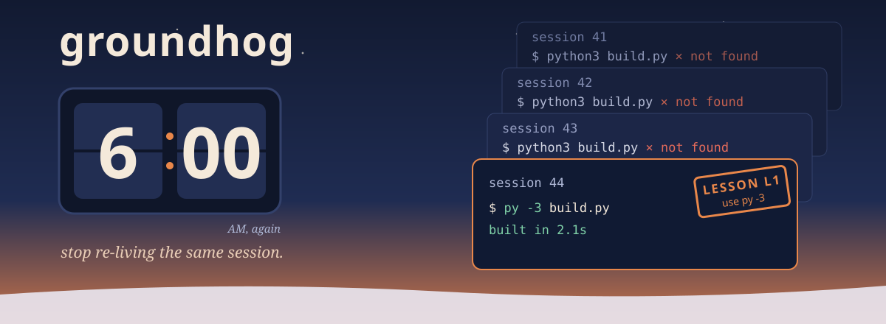

<p align="center"></p>

**groundhog** finds the mistakes your agents make every session and the procedures they keep doing by hand. It reads past transcripts for three things: **lessons** (a command fails, then a related one works, again and again), **sequences** (the same steps run by hand across many sessions), and **friction** (commands that keep failing). Lessons you accept go into a committed ledger, and hooks enforce them, so the same mistake costs nothing next time.

In *Groundhog Day*, Phil wakes up at 6:00 AM to the same day until he finally learns from it. Your agents wake up every session with no memory of yesterday's dead ends.

<p align="center"><a href="#install">Install</a> · <a href="#how-it-works">How it works</a> · <a href="#commands">Commands</a> · <a href="#is-it-working-groundhog-stats">Stats</a> · <a href="#evidence">Evidence</a></p>

## Why

Longer instructions don't stop repeat mistakes. A rule in `CLAUDE.md` or `AGENTS.md` costs tokens in every session and still gets skipped. A hook costs nothing until the mistake is about to happen, and then it fires every time.

Across one developer's last 30 days (1,187 sessions, 81k shell commands), the same lessons were re-learned over and over:

- `pnpm -s db:seed --env` failed, then `pnpm db:seed --env dev` worked, in **14 separate sessions**.
- `dotnet build` then `dotnet test --no-build` was run by hand in **71 sessions**: a verify script nobody wrote.
- `python` / `python3` failed and `py -3` worked, session after session.

## How it works

| Piece | What it does |
|---|---|
| **Miner** | Reads transcripts and normalizes each shell command to its shape (paths, strings and numbers generalized; `cd` prefixes and wrappers stripped; `npx tsc` and `npx vitest` kept apart). Looking around (grep, cat, ls) is ignored. A lesson needs the fix to be *related* to the failure, to recur in 2+ sessions, and to point one way: A→B and B→A both is flailing, not a fix. |
| **Ledger** | `groundhog.lessons.json`, committed: each lesson is a command pattern, what to do instead, and which shell it applies to. You accept mined lessons (or write your own); nothing is enforced without review. |
| **Hooks** | `SessionStart` injects the ledger as a short list. `PreToolUse` on shell commands blocks the first matching command per session with the fix, then lets it through with a reminder, so a false positive can never deadlock the agent. |
| **Runbook drafts** | `groundhog draft S3` turns a repeated sequence into an Agent Skill draft. Adopt it into your skill library; when its steps stop changing, promote it to a script. |
| **Stats** | `.groundhog-stats.json`: injections, guard hits and denies, and whether each accepted lesson's failing command still recurs. |

## Example

```
$ groundhog scan && groundhog report
Lessons: the same error, then the same workaround (accept with: groundhog accept L<n>)
  L1  x14 in 14 sessions  pnpm -s db:seed --env  =>  pnpm db:seed --env dev
Sequences run by hand again and again (draft a runbook with: groundhog draft S<n>)
  S1  71 sessions  dotnet build P -v  >  dotnet test P --no-build

$ groundhog accept L1
L1 added (deny-once): when /pnpm\s+-s\s+db:seed\s+--env/ -> this form fails here; what worked: pnpm db:seed --env dev
```

Next session, the agent starts with the lesson in context. If it reaches for the old command anyway, the hook stops it once with the fix.

## Install

<!-- generated:install (by scripts/sync.mjs from scripts/platforms.mjs; edit those, not this block) -->
**Claude Code**

```bash
claude plugin marketplace add grexican/groundhog
claude plugin install groundhog@groundhog        # add -s project to share it with your team
```

**Any other agent**: one command from a clone (Node 22.13+). It copies the skills, merges the hooks and MCP config into the project, and is safe to re-run; `--uninstall` removes exactly what it added.

```bash
git clone https://github.com/grexican/groundhog
node groundhog/dist/install.mjs --platform cursor --project .   # or: claude, codex, gemini, copilot, windsurf
```

Native packages are in [`adapters/`](adapters/): a Cursor plugin, a Codex plugin and a Gemini CLI extension. Copilot reads this repo's Claude plugin manifest directly. No Node on the machine? Use the `belt` native binary from [utility-belt](https://github.com/grexican/utility-belt#no-node-native-binary).

| Platform | What works |
|---|---|
| Claude Code | everything |
| GitHub Copilot (CLI, VS Code) | mining reads Claude Code transcripts today |
| Cursor | mining reads Claude Code transcripts today |
| OpenAI Codex | mining reads Claude Code transcripts today |
| Gemini CLI | mining reads Claude Code transcripts today |
| Windsurf / Devin | no session-start context; the guard blocks; mining reads Claude Code transcripts today |
<!-- /generated:install -->

## Commands

```bash
groundhog scan [--days 30] [--all-projects]    # mine recent transcripts
groundhog report [--json]                      # numbered candidates: L (lessons), S (sequences), F (friction), R (repeats)
groundhog accept L3                            # add a mined lesson to the ledger
groundhog add --when '<regex>' --instead '<what to do>' [--remind]   # write one by hand (--remind never blocks)
groundhog lessons                              # list the ledger
groundhog draft S2 --name verify-backend       # runbook skill draft under .groundhog/drafts/
groundhog stats                                # is it working?
```

**Review every lesson before you accept it.** Mined fixes can go stale: on one machine the top mined lesson was "`python` fails, use `python3`", but by then both were broken and only `py -3` worked. The ledger got the corrected lesson instead.

## Is it working? `groundhog stats`

```
groundhog stats since 2026-10-14 (updated 2026-10-14 12:51)
lessons accepted 1 | session injections 1 | guard hits 2 (denied 1) | drafts 0
last scan: 248 sessions, 23164 shell calls; 68 repeated shapes, 2 lesson candidates, 50 sequences
no accepted lesson has recurred since it was accepted
```

The number that matters is the last line: an accepted lesson whose failing command keeps running means the wording or the pattern needs work.

## Configure

`groundhog.config.json` at the repo root. All keys are optional:

```json
{ "days": 30, "minSessions": 5, "minRecoveries": 3, "minSequence": 3, "guard": "deny-once", "lessons": "groundhog.lessons.json" }
```

`guard`: `off` · `remind` (context only) · `deny-once` (default). `GROUNDHOG_STATS=0` turns the stats file off.

## Evidence

- **Verified live in Claude Code:** the lesson was injected at session start, the matching command was denied once and allowed on the forced retry, and the agent named the lesson in its answer.
- **The miner was tuned on real data, not by feel.** The first scan proposed "`tsc` fails → `vitest` works" (two steps of a verify run, not a fix) and missed the real Python lessons. Runner-aware program names, kept inline scripts and the one-way rule fixed both.

## Requirements

Node 22.13+. Transcripts: Claude Code today; the reader is pluggable for other agents.

## Part of the utility belt

<!-- generated:family -->
groundhog is one of four agent tools that share a core and a release train in [grexican/utility-belt](https://github.com/grexican/utility-belt). Each installs and works on its own. Issues and pull requests go to the monorepo.

| Tool | |
|---|---|
| [**headjack**](https://github.com/grexican/headjack) | Skills, loaded the moment you need them: an indexed skill library and a per-prompt retrieval hook instead of a preloaded listing. |
| [**middleout**](https://github.com/grexican/middleout) | API calls, compressed: agents write one small plan, and only the fields they selected reach the model. |
| [**moneyball**](https://github.com/grexican/moneyball) | Pay for the model each job needs: measure every subagent run, graduate repeat work to cheaper models on evidence. |
| **groundhog** (you are here) | Stop re-living the same session: re-learned lessons become a committed ledger that hooks enforce, and repeated procedures become runbooks. |
<!-- /generated:family -->

---

*groundhog is an original project. It is not affiliated with Columbia Pictures or Groundhog Day, and the illustration is original artwork.*
