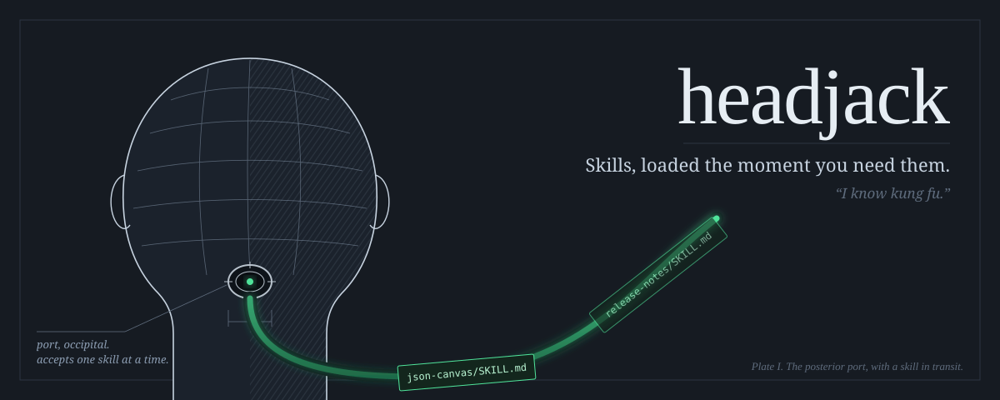

<p align="center"></p>

**headjack** gives an agent its skills just in time. It does not preload a listing of every skill at session start. The agent starts with two small root skills, and a hook finds the right skill for each request and tells the agent to load it.

In *The Matrix*, the headjack is the port at the base of the skull through which Tank uploads a training program, the moment Neo needs it. Neo opens his eyes: "I know kung fu." Same idea.

<p align="center"><a href="#install">Install</a> · <a href="#how-it-works">How it works</a> · <a href="#build-your-library">Build your library</a> · <a href="#is-it-working-headjack-stats">Stats</a> · <a href="#evidence">Evidence</a></p>

## Why

Preloading skills does not scale, and it does not guarantee use.

- **The descriptions get cut.** Past a listing budget, Claude Code keeps every skill's name but drops its description (measured on Claude Code 2.1.285: about 8 skills keep a description on Haiku, about 105 on Sonnet). A skill asked for by name still works, but a request in the user's own words can't be matched to a skill whose description isn't in context.
- **Preloaded skills often get skipped.** In our tests, an agent with 377 skills installed natively used the right one 33% of the time.
- **Skipping costs quality.** A blind judge scored outputs against the skill that should have applied: 6 vs 2 on an ads audit, 9 vs 4–5.5 on a canvas file, 6 vs 1 on a decision council. Skills that hold *your* conventions (formats, checklists, house rules) are the ones that matter, and the ones a model cannot guess.

headjack keeps the library out of context until a task needs it, and it makes the agent check that library every time.

## How it works

| Piece | What it does |
|---|---|
| **Library** | Skill folders (`SKILL.md`) in two spaces, indexed into one local SQLite file with BM25 and local embeddings (MiniLM, fused by reciprocal rank). Nothing is sent anywhere. |
| **Hook** | On every prompt, `UserPromptSubmit` runs a lite retrieval (~0.5–1 s) and names the best-matching skills. It injects nothing (zero tokens) when nothing is relevant. |
| **Root skills** | `find-skill` and `load-skill`: the only skills Claude Code preloads. The agent uses them to search and load. |
| **Registry fall-through** | When nothing local is a strong match, it searches the public [skills.sh](https://skills.sh) registry on the request's terms your library has never seen, and offers the candidates (unvetted). |
| **Stats** | Every suggestion, search and load is upserted into `.headjack-stats.json`, so you can see whether it is used and whether it helps. |

Why the hook does the search: models do not escalate on their own. With only a reminder ("search before you start"), Opus and Sonnet found the right skill reliably, but Haiku never did (0/6). When the hook does the retrieval and names the matches, Haiku went to 4/6, and runs got cheaper on average ($0.17 vs $0.59 per run).

## Install

<!-- generated:install (by scripts/sync.mjs from scripts/platforms.mjs; edit those, not this block) -->
**Claude Code**: one marketplace for every Q Branch gadget; install only the ones you want.

```bash
claude plugin marketplace add grexican/qbranch
claude plugin install headjack@qbranch        # add -s project to share it with your team
```

**Any other agent**: one command from a clone (Node 22.13+). It copies the skills, merges the hooks and MCP config into the project, and is safe to re-run; `--uninstall` removes exactly what it added.

```bash
git clone https://github.com/grexican/qbranch
node qbranch/packages/headjack/dist/install.mjs --platform cursor --project .   # or: claude, codex, gemini, copilot, windsurf
```

Native packages are in [`adapters/`](adapters/): a Cursor plugin, a Codex plugin and a Gemini CLI extension. Copilot reads the Claude plugin marketplace directly. No Node on the machine? Use the `qbranch` native binary ([how](../../README.md#no-node-native-binary)).

| Platform | What works |
|---|---|
| Claude Code | everything |
| GitHub Copilot (CLI, VS Code) | no per-prompt context (the platform cannot inject at prompt time) |
| Cursor | no per-prompt context (the platform cannot inject at prompt time) |
| OpenAI Codex | everything |
| Gemini CLI | everything |
| Windsurf / Devin | no per-prompt context (the platform cannot inject at prompt time) |
<!-- /generated:install -->

## Build your library

Skills live in two spaces. Neither one is preloaded.

| Space | Where | For |
|---|---|---|
| **shared** | `.headjack/library/` in the repo | the team's skills: commit them |
| **personal** | `~/.headjack/library/` | yours, available in every project |

```bash
headjack init                                   # set up .headjack/ in this repo
headjack adopt                                  # move this repo's .claude/skills/* into the shared library
headjack adopt --from user                      # move ~/.claude/skills/* into your personal library
headjack add ./some-skill --personal            # add a folder
headjack add hashicorp/agent-skills/terraform-style-guide   # fetch from GitHub (review it: unvetted)
headjack new release-notes                      # scaffold a new skill
headjack move personal/release-notes --to shared   # promote yours to the team
headjack source add ../team-skills              # index a folder in place, without moving it
headjack list                                   # everything, by space
```

**Bundles: one trigger, an ordered set.** Some work always takes the same skills in the same order, for example a review chain that runs a principles pass, then a code-quality pass, then a security pass on every PR. A bundle is a skill that lists others. Search matches the bundle's description, and loading it loads every member in order, numbered:

```bash
headjack bundle pr-review principles-pass code-quality security-pass --description "Full PR review chain. Use when reviewing a pull request."
headjack get pr-review          # "Bundle loaded: shared/pr-review (3 skills, apply them in this order)"
```

`adopt` never moves the root skills. Skills that a plugin owns stay with their plugin. Index the plugin's skills folder with `headjack source add <dir>` and turn that plugin's preload off.

A skill's `description` is what search matches on. Write what the skill does, then "Use when ..." with the words a request would contain.

### Every move is on the record, and leaving is one command

Everything that enters or leaves a library space is appended to a **ledger** next to it: `.headjack/ledger.jsonl` for the shared space (commit it with the team's skills) and `~/.headjack/ledger.jsonl` for yours. Each line says what happened (`adopt`, `add`, `acquire`, `new`, `bundle`, `move`, `release`), where the skill came from, and a hash of its content. Paths are stored relative to the project or as `~/`, so the shared ledger reads the same on every machine. Skills fetched from the registry are pinned to the exact commit they came from.

```bash
headjack history                     # everything, oldest first
headjack history terraform-style-guide
# 2026-10-15 15:02  acquire  shared/terraform-style-guide  from hashicorp/agent-skills/terraform-style-guide
#                            [registry:https://github.com/hashicorp/agent-skills/tree/f706481a.../terraform-style-guide]
```

To go back, `release` moves skills out of the library to **exactly where they were adopted from**. It tells you when a skill was edited while it lived in headjack, and it never overwrites anything already there:

```bash
headjack release shared/legacy-skill            # back to .claude/skills/legacy-skill
headjack release --all --dry-run                # what leaving headjack would move, and where
headjack release --all                          # empty the library; then uninstall the plugin
headjack release personal/my-style --to user    # or choose: project | user | <dir>
```

The ledger survives a release, so the full history of what came and went stays with the repo.

## Is it working? `headjack stats`

```
headjack stats since 2026-10-14 (updated 2026-10-14 07:46)
worth it? net +3,412 tokens (3,960 kept out of startup, 548 injected) | suggestion -> load conversion 50% (2/4) | loads 2
~3,960 tokens kept out of startup (12 sessions, 330 each today; subagents not counted; assumes these skills would otherwise be installed)
prompts 40 | with suggestions 3 (8%) | harness prompts skipped 22 | repeats suppressed 1
searches 0 (weak 0, external 0) | registry suggestions 0 | acquires 0
most loaded (loads/suggested): shared/json-canvas 2/2
```

| Signal | What it tells you |
|---|---|
| **worth it?** | Net tokens: the skill descriptions kept out of every session's startup listing, minus what suggestions injected. Plus whether agents act on suggestions |
| **suggestion → load conversion** | Do agents act on what the hook finds? |
| **harness prompts skipped / repeats suppressed** | Noise the hook refused to add: subagent notifications and command output are not requests, and a skill is named once per session |
| **suggested often, never loaded** | Which skills to rewrite or delete, each with an example prompt that triggered it (the last 30 suggestions are kept in `trail`) |
| **library gaps** | The last requests nothing in the library could serve: your harvest list, with registry candidates |

Registry candidates are offered at most once per session, and only when the request names what the skill is about (an idiom like "crush it" does not pull in `objection-crusher`).

The file is plain JSON at the repo root. Commit it to track a team, or add it to `.gitignore` to keep it local. Set `"stats": false` in `headjack.config.json` (or `HEADJACK_STATS=0`) to turn it off.

## Configure

`headjack.config.json` at the repo root (team settings) and `~/.headjack/config.json` (yours). All keys are optional:

```json
{
  "sources": ["../team-skills"],
  "strong": 0.35,
  "suggestMax": 4,
  "external": true,
  "stats": ".headjack-stats.json"
}
```

## Other agent runtimes

The engine is a plain library, with no Claude Code required:

```js
import { loadConfig, suggest, search, load } from 'headjack';
const cfg = loadConfig('/path/to/project');
const context = await suggest(cfg, userMessage);   // put this in front of your agent's turn
```

`headjack mcp` serves the same engine as an MCP server (`headjack_find`, `headjack_get`, `headjack_acquire`) for MCP clients without skills.

## Evidence

The design came out of ~340 headless Claude Code runs (up to 9 variants × 8 tasks × 3 models) plus 135 blind adherence grades.

| Design | Right skill loaded |
|---|---|
| All skills preloaded (native) | 33% |
| Root skills, no hook | 33% |
| Root skills + reminder hook | 56% |
| **Hook that retrieves + names matches** | **67%** (the only one that worked on Haiku) |

The existing `find-skills` skill, a human-facing installer, never fired on a task (0/18).

## Requirements

Node 22.13+ (it uses the built-in `node:sqlite`). The first run downloads the embedding model (~23 MB) to `~/.qbranch/models`. Without it, search falls back to BM25.

## From Q Branch

<!-- generated:family -->
headjack is a gadget from [Q Branch](../../README.md), the workshop where tools for AI agents get built and proven. The gadgets share a core and a release train, and each one installs and works on its own.

| Tool | |
|---|---|
| **headjack** (you are here) | Skills, loaded the moment you need them: an indexed skill library and a per-prompt retrieval hook instead of a preloaded listing. |
| [**middleout**](../middleout) | API calls, compressed: agents write one small plan, and only the fields they selected reach the model. |
| [**moneyball**](../moneyball) | Pay for the model each job needs: measure every subagent run, graduate repeat work to cheaper models on evidence. |
| [**groundhog**](../groundhog) | Stop re-living the same session: re-learned lessons become a committed ledger that hooks enforce, and repeated procedures become runbooks. |
<!-- /generated:family -->

---

*headjack is an original project. It is not affiliated with The Matrix or Warner Bros., and the illustration is original artwork.*
