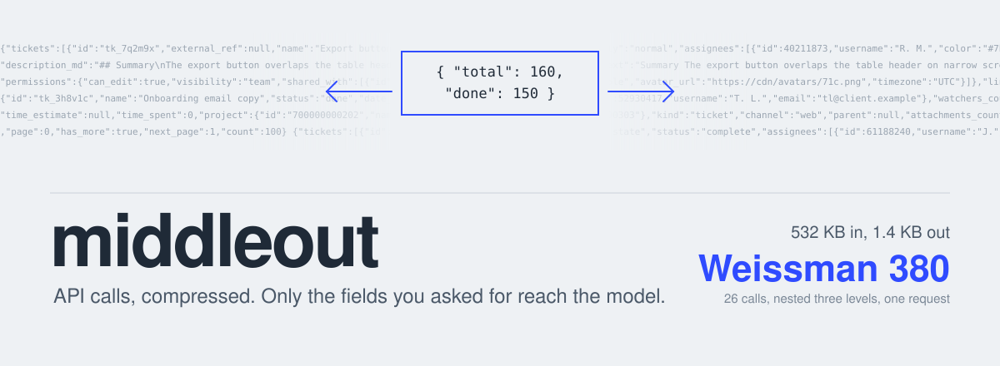

<p align="center"></p>

**middleout** sits between an agent and its MCP servers. The agent no longer calls a tool once per item and reads every bloated payload. It writes one small plan, and middleout runs that plan on the server side: chained calls, one-to-many fan-out, nesting and automatic pagination. Only the fields the agent selected come back.

The name comes from *Silicon Valley*, whose fictional compression algorithm worked "middle-out". middleout's stats file reports a **Weissman score**: raw bytes in ÷ bytes handed to the model.

<p align="center"><a href="#install">Install</a> · <a href="#how-it-works">How it works</a> · <a href="#configure">Configure</a> · <a href="#is-it-working-middleout-stats">Stats</a> · <a href="#when-you-do-not-need-it">When not to use it</a></p>

## Why

API payloads are built for apps, not for context windows. A ticket-detail call returns the description twice. A list call drags along avatars, audit metadata and custom fields. Ask "who opened the tickets in this queue?" and an agent makes 37 detail calls and reads every one of them.

Tested against a production ticketing system's MCP server (read-only, ground truth computed separately):

| Question | Opus: raw MCP | Opus: middleout |
|---|---|---|
| Who created each of 37 tickets in a queue? (37 detail fetches) | $1.31 | **$0.17** |
| Total + per-assignee counts over 160 tickets (2 pages) | $0.48 | $0.25 |
| Ticket and resolved counts across 4 queues | $0.84 | $0.40 |

All answers were correct both ways. On a synthetic CRM with three-level nesting, raw MCP cost $2.42 with a 303k-token peak context; middleout cost $0.17 with a 33k peak. Smaller models struggle with raw API mechanics: Haiku went from 0/3 to 3/6 on the live tasks once middleout handled pagination and junk arguments for it.

## How it works

It is a combination, shipped as one Claude Code plugin:

| Piece | Role |
|---|---|
| **Tool** (MCP server) | `middleout_tools`, `middleout_shape`, `middleout_run`. It wraps the MCP servers in your project's `.mcp.json` (stdio, Streamable HTTP and SSE; no config needed), or the ones you list. |
| **Skill** | How to write plans: recipes for projection, fan-out, nesting and aggregation, plus the pitfalls. |
| **Hook (the lens)** | Shapes the native MCP call's result, through the agent's own connection and sign-in: an extra `"_middleout": {"select": ...}` argument is stripped before the server sees it and applied to the result; more pages come back as a one-line "call again with ..." until the merged result arrives; `each` fans out into per-item calls; a big result without a sidecar is compacted, with the full result saved to a file. Elsewhere it measures raw calls and nudges toward middleout. In `gate` mode, on harnesses without the lens, it blocks the first raw call to a wrapped server per session. |
| **Stats** | Upserts `.middleout-stats.json`: calls, bytes in and out, the Weissman score, tokens kept out of context, and the raw traffic that bypassed middleout. |

A plan looks like this:

```json
{ "tool": "crm.list_accounts", "args": { "tier": "enterprise" }, "select": "accounts[].{id: id, name: name}",
  "each": { "as": "deals", "tool": "crm.list_deals", "args": { "account_id": "{{id}}" }, "select": "deals[].{id: id, name: name}",
    "each": { "as": "calls", "tool": "crm.list_activities", "args": { "deal_id": "{{id}}" }, "select": "length([?type=='call'])" } } }
```

`select` and `then` are [JMESPath](https://jmespath.org). `{{field}}` templates read the current item. `{{_parent.field}}` reads its parent.

## What middleout does for the agent

It handles the API mechanics that small models get wrong:

- **Pagination is automatic, in every common style:** cursors and tokens (top level or nested, as in Slack, HubSpot and GraphQL `pageInfo`), next-page URLs and Link headers, page numbers (0- or 1-based), offsets, Stripe's `starting_after`, and DynamoDB keys. The request uses the tool's own parameter names, loops are caught, and a capped or incomplete result says so. (Haiku used 1-based pages on a 0-based API, and forgot to paginate.)

### The lens, harness by harness

The lens needs a hook that can rewrite a tool result. Each harness gets the best it supports:

| Harness | Result rewrite | Sidecar stripping | What middleout does there |
|---|---|---|---|
| Claude Code | `updatedToolOutput` | `updatedInput`, permission flow untouched | full lens |
| Cursor | `updated_mcp_tool_output` (MCP only) | `updated_input` (counts as an approval) | full lens; write-like tools never get a sidecar |
| Copilot CLI / VS Code | `modifiedResult` | `modifiedArgs` (counts as an approval) | full lens; write-like tools never get a sidecar |
| Codex | `block` + `reason` replaces the result | `updatedInput` + allow (counts as an approval) | full lens; write-like tools never get a sidecar |
| Gemini CLI | none clean (deny shows as an error) | merge only, a key cannot be removed | `middleout_run` + nudges |
| Windsurf | none | none | `middleout_run` + gate |

`"lens": false` in `middleout.config.json` (or `MIDDLEOUT_LENS=0`) turns it off.
- **Empty-string arguments are dropped.** Models send `""` for optional params, and APIs reject them.
- **Fan-out runs in parallel** with a concurrency cap.
- **Errors name the node that failed** (`at plan[0].deals[3].calls: ...`), so the agent can fix the plan.

## What it will call, and what that means

middleout wraps **every** tool your servers expose. It is a pass-through: a plan can call anything a raw MCP call could, including a POST that is really a search, which is common and which a read-only filter would wrongly exclude.

Two consequences worth knowing:

- **A plan runs under one approval.** Your agent is prompted once for `middleout_run`, and the plan may then make many calls. A fan-out over 100 items is 100 calls. That is the point of the tool, and it is why middleout's own annotations do not claim to be read-only: it is exactly as safe as the tools the plan names.
- **Narrow it when you want to.** `allow` (a regex on `server.tool`) limits middleout to the tools you list. `"readonly": true` restricts it to tools their own server annotates `readOnlyHint` — accurate when servers set that hint, but most do not, so it is off by default.

## Install

<!-- generated:install (by scripts/sync.mjs from scripts/platforms.mjs; edit those, not this block) -->
**Claude Code**: one marketplace for every Q Branch gadget; install only the ones you want.

```bash
claude plugin marketplace add grexican/qbranch
claude plugin install middleout@qbranch        # add -s project to share it with your team
```

**Any other agent**: one command from a clone (Node 22.13+). It copies the skills, merges the hooks and MCP config into the project, and is safe to re-run; `--uninstall` removes exactly what it added.

```bash
git clone https://github.com/grexican/qbranch
node qbranch/packages/middleout/dist/install.mjs --platform cursor --project .   # or: claude, codex, gemini, copilot, windsurf
```

Native packages are in [`adapters/`](adapters/): a Cursor plugin, a Codex plugin and a Gemini CLI extension. Copilot reads the Claude plugin marketplace directly. No Node on the machine? Use the `qbranch` native binary ([how](../../README.md#no-node-native-binary)).

| Platform | What works |
|---|---|
| Claude Code | everything |
| GitHub Copilot (CLI, VS Code) | everything |
| Cursor | everything |
| OpenAI Codex | everything |
| Gemini CLI | everything |
| Windsurf / Devin | no post-call measurement and nudges, no session-start context; MCP server goes in your user-level mcp_config.json |
<!-- /generated:install -->

## Configure

In a project with a `.mcp.json`, that is all: middleout wraps its servers, stdio and HTTP alike. To customize, run `middleout init` and edit `middleout.config.json`:

```json
{
  "servers": { "tickets": { "command": "node", "args": ["./mcp/tickets-server.mjs"] } },
  "readonly": false,
  "allow": null,
  "mode": "nudge",
  "nudgeBytes": 8000,
  "concurrency": 8,
  "stats": ".middleout-stats.json"
}
```

`mode`: `off` (measure only), `nudge` (default), or `gate`. Gate never blocks write-like tools.

### HTTP servers and sign-in

HTTP entries (`"type": "http"` or `"sse"`, with a `url`) are wrapped like stdio ones. `headers` values expand `${VAR}` and `${VAR:-default}` from the environment, so an API key stays in your env:

```json
{ "mcpServers": { "tickets": { "type": "http", "url": "https://tickets.example.com/mcp", "headers": { "Authorization": "Bearer ${TICKETS_TOKEN}" } } } }
```

For an OAuth server, middleout is its own client, separate from your editor's sign-in. Sign in once:

```
middleout login tickets
```

This opens a browser (PKCE, dynamic client registration, or the `oauth.clientId` / `oauth.callbackPort` from `.mcp.json`) and stores the tokens in `~/.qbranch/middleout/oauth/` (owner-only; `MIDDLEOUT_HOME` moves it). Tokens refresh on their own; concurrent sessions share the token file safely (a lock, and a refresh that loses a race keeps the winner's tokens). A server that answers without auth is remembered, so it is never reported as needing sign-in. Errors that reach the stats file are scrubbed of URL query strings, user info and the values of `${VAR}`s from `.mcp.json`. The MCP server never opens a browser: until you sign in, a plan against that server returns a "needs sign-in" error that names this command, and `middleout servers` lists it as unavailable while every other server keeps working.

## Is it working? `middleout stats`

```
middleout since 2026-10-14: ~19.2k tokens kept out of context (an upper bound vs. the raw results: 67 KB raw -> 1 KB returned, Weissman score 55.1)
coverage: 88% of the traffic middleout can handle went through it | 3/4 nudges converted (75%)
through middleout: 3 runs, 15 API calls, 6 pages auto-fetched | errors 0
  per tool:
    tickets.list_tickets  2 runs, 9 API calls  52 KB -> 1 KB (saved 51 KB)
    tickets.get_ticket    1 run, 6 API calls  15 KB -> 0 KB (saved 15 KB)
still raw, could go through middleout (2 calls, 9 KB):
    tickets.search: 2 calls, 9 KB
ignored (not middleout's job): 4 writes (1 KB), 6 binary results such as screenshots (310 KB)
```

The first line is the payoff, counted against the raw results. It is an upper bound: an agent working raw might have fetched fewer pages. "Coverage" is the honest number: the share of the traffic middleout could have handled (reads from wrapped servers) that actually went through it. If it stays low, switch to `gate` or check the skill. Raw traffic is split so it never inflates the misses: writes and binary results (screenshots, images) are ignored, and servers middleout does not wrap are listed apart. A nudge counts as converted when the same session's next fetch from that server goes through middleout. The last few errors are shown too. Commit the file to track a team, or `.gitignore` it. `"stats": false` (or `MIDDLEOUT_STATS=0`) turns it off.

## When you do not need it

Inside Claude Code with a strong model, writing a quick script against the API ("code mode") was about as cheap in our tests, and Claude Code already spills huge single results to disk. middleout earns its place with **per-item fan-out over chatty APIs**, with **smaller models**, and in **deployed agents** that have no code sandbox. There, a declarative plan is safer than running model-written code.

## Other agent runtimes

```js
import { createEngine } from 'middleout';
const engine = createEngine({ servers: { crm: { command: 'node', args: ['crm-server.mjs'] } } });
const { result, stats } = await engine.run(plan);   // expose engine.run as one tool in your agent framework
```

Requires Node 20.11+.

## From Q Branch

<!-- generated:family -->
middleout is a gadget from [Q Branch](../../README.md), the workshop where tools for AI agents get built and proven. The gadgets share a core and a release train, and each one installs and works on its own.

| Tool | |
|---|---|
| [**headjack**](../headjack) | Skills, loaded the moment you need them: an indexed skill library and a per-prompt retrieval hook instead of a preloaded listing. |
| **middleout** (you are here) | API calls, compressed: agents write one small plan, and only the fields they selected reach the model. |
| [**moneyball**](../moneyball) | Pay for the model each job needs: measure every subagent run, graduate repeat work to cheaper models on evidence. |
| [**groundhog**](../groundhog) | Stop re-living the same session: re-learned lessons become a committed ledger that hooks enforce, and repeated procedures become runbooks. |
<!-- /generated:family -->

---

*middleout is an original project. It is not affiliated with HBO or Silicon Valley, and the illustration is original artwork.*
