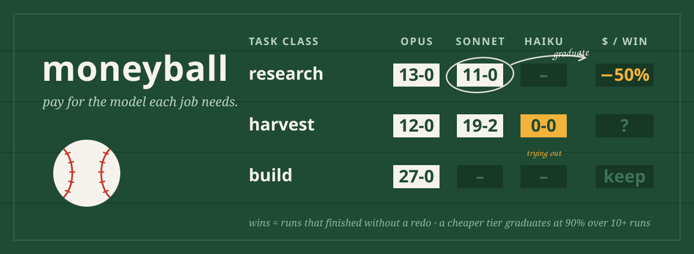

<p align="center"></p>

**moneyball** reads your agents' session transcripts and measures every subagent run: which model ran it, what it cost, and whether it worked. When a kind of task keeps succeeding on a cheaper model, moneyball graduates it, and a hook routes the next dispatch there.

In *Moneyball*, the Oakland A's could not afford stars, so they stopped paying for reputation and paid for what the numbers said wins games. Same idea: stop sending every errand to your most expensive model on gut feel.

<p align="center"><a href="#install">Install</a> · <a href="#how-it-works">How it works</a> · <a href="#commands">Commands</a> · <a href="#is-it-working-moneyball-stats">Stats</a> · <a href="#evidence">Evidence</a></p>

## Why

Subagents default to the strongest model, and nobody checks afterwards. In one developer's last 30 days:

- **Subagents were 51% of spend.** 98% of that ran on the two most expensive tiers.
- **192 narrow, checkable runs** (status checks, QA walks, lookups) cost **$927 on frontier models**. At small-model rates they would have cost about $23.
- **Nobody knew which runs could move.** Guessing is risky: a cheaper model that fails and gets re-run is not cheaper.

moneyball replaces the guess with evidence from runs you already made.

## How it works

| Piece | What it does |
|---|---|
| **Scan** | Reads Claude Code transcripts (main sessions and every subagent). Prices each run from its token usage, and judges success: a run **failed** if it was redone (same task, same session, within 30 min), if its report says it could not finish, or if most of its tool calls errored. |
| **Task classes** | Agent type + the leading verb of the description (`general-purpose:research`, `Explore:audit`). Coarse on purpose: real descriptions are nearly unique, and the verb is all a hook can see at dispatch time. |
| **Recommendations** | Per class: **graduate** (the cheaper tier did it ≥10 times at ≥90% success, and is cheaper *per completed task*), **explore** (mechanical work with no evidence yet on the cheaper tier), **try-effort** (unclear work: lower the effort on the same model first; caches are per model), or **keep**. A class failing on its current model gets "fix the brief, or move it up", never a cheaper model. |
| **Hook** | `PreToolUse` on the subagent tool. Looks the dispatch up in the routing table and, by mode, says nothing, adds a note, rewrites the `model`, or (explore) sends a small share one tier down so the cheaper model earns its evidence. A model the caller pinned is never overridden. |
| **Startup tax** | `overhead` measures the fixed prompt every session and subagent pays, attributes it to components, and `tune` tests trimmed variants. See [The startup tax](#the-startup-tax). |
| **Stats** | `.moneyball-stats.json`: dispatches seen, suggestions, rewrites, exploration trials, the estimated saving, the startup tax, and the last experiment. |

Modes (`moneyball.config.json` → `"mode"`): `report` · `suggest` (default) · `enforce` · `explore`.

## Example

```
$ moneyball scan
scanned 265 subagent transcripts (+265 new): 265 runs, 117 classes, $1815.20; 1 graduated, 1 exploring, est. saving $81.16

$ moneyball report
graduate      $78.84  general-purpose:research
                     [mechanical] opus 13/13, sonnet 11/11 -- sonnet passed 11/11 (100%) vs opus 100% (est. $59.99)
explore       $67.34  general-purpose:harvest
                     [mechanical] opus 12/12, sonnet 19/21 -- mechanical, 21 runs on sonnet, 0/10 trials on haiku
keep         $406.35  general-purpose:build
                     [judgment] opus 27/27 -- judgment work: leave it on the strong model
```

With `"mode": "suggest"`, the next research dispatch carries a note: *this task class succeeds on sonnet; prefer it*. With `enforce`, the hook rewrites the dispatch's model itself.

## Install

<!-- generated:install (by scripts/sync.mjs from scripts/platforms.mjs; edit those, not this block) -->
**Claude Code**: one marketplace for every Q Branch gadget; install only the ones you want.

```bash
claude plugin marketplace add grexican/qbranch
claude plugin install moneyball@qbranch        # add -s project to share it with your team
```

**Any other agent**: one command from a clone (Node 22.13+). It copies the skills, merges the hooks and MCP config into the project, and is safe to re-run; `--uninstall` removes exactly what it added.

```bash
git clone https://github.com/grexican/qbranch
node qbranch/packages/moneyball/dist/install.mjs --platform cursor --project .   # or: claude, codex, gemini, copilot, windsurf
```

Native packages are in [`adapters/`](adapters/): a Cursor plugin, a Codex plugin and a Gemini CLI extension. Copilot reads the Claude plugin marketplace directly. No Node on the machine? Use the `qbranch` native binary ([how](../../README.md#no-node-native-binary)).

| Platform | What works |
|---|---|
| Claude Code | everything |
| GitHub Copilot (CLI, VS Code) | reads VS Code Copilot Chat and Copilot CLI sessions (storage verified; message details unverified); routing applies where the subagent tool takes a model argument |
| Cursor | reads your Cursor history (verified on real data); Cursor records no tokens, so runs are judged on outcomes and savings show as unknown; advice only (a hook cannot set a Cursor subagent's model) |
| OpenAI Codex | reads Codex rollouts with token usage (format checked against the Codex source, not yet seen on a real install); routing needs a subagent tool with a model argument |
| Gemini CLI | reads Gemini CLI chats with token usage (format checked against the Gemini CLI source, not yet seen on a real install); no subagent model routing |
| Windsurf / Devin | no pre-call guard, no session-start context; CLI reports only; no Windsurf transcript reader yet |
<!-- /generated:install -->

## Commands

```bash
moneyball scan [--days 30] [--all-projects]   # measure new runs, rebuild the routing table (also runs in the background at session start)
moneyball report [--all] [--json]             # every class: graduate | explore | try-effort | keep, with the evidence
moneyball stats                               # is routing being applied, and what is it worth?
moneyball overhead [--probe --budget 0.25]    # the startup tax, apart from the work; --probe attributes it to components
moneyball experiments [--condense --budget U] # derive trimmed startup-context variants (never touches live files)
moneyball tune --budget 5                     # replay recurring tasks under each variant; recommend only safe trims
```

## Every vendor's ladder

Model names parse into a rung: vendor, model and reasoning effort. Claude, GPT, Gemini, Grok and Cursor's Composer are all covered, including editor-style names like `cursor-grok-4.6-high-fast`. The cheaper rungs come in a fixed order:

1. **lower effort on the same model** (`grok-4.7-high` → `grok-4.7`, `opus-thinking-high` → `opus`): the smallest change, and the prompt cache survives;
2. **the next size down from the same vendor and version** (`opus` → `sonnet`, `gpt-5.2` → `gpt-5.2-mini`, `gemini-3-pro` → `gemini-3-flash`).

An older version is never treated as a cheaper rung. An editor's automatic pick (`default`) is measured but not tuned. Only Claude rungs can be enforced by the hook; for other vendors, moneyball's recommendations are advice.

From one developer's Cursor history: `grok-4.7` at default effort finished **99.4%** of 163 subagent runs, against **97.8%** of 137 at `-high`. On that evidence, high effort wasn't buying anything.

## The startup tax

Every session and every subagent pays a fixed prompt before it does any work: the system prompt, built-in tool schemas,
CLAUDE.md and rules, the skills and commands listing, MCP tool schemas, and memory. The number of tokens is the same
whichever model runs, so a cheaper model doesn't remove the tax. It only makes each token cheaper. A common
recommendation when new models ship is to wipe your CLAUDE.md, agent files and scripts and start fresh, because they
often compensate for weaknesses the new model no longer has. moneyball does this on evidence instead of folklore:

```
$ moneyball overhead --probe --budget 0.40
startup tax, last 30 days: the fixed prompt paid before any work (system prompt, instructions, skills, MCP, memory)
  subagents    275  median  51,874  p90  60,619 tokens
  sessions      31  median  68,350  p90  81,036 tokens
  tax $67.59 of $3983.06 total = 1.7% of spend; the work itself: $3915.47

static contributors (on disk, ~4 chars/token, no spend)
  project     2,484  CLAUDE.md
  skills      2,836  ~/.claude/skills (19 entries)
  commands    1,633  .claude/commands (50 entries)
  mcp         probe  browser (seen in transcripts)  2204 tool calls in window
  ...

probe attribution (haiku, $0.28 spent): full startup prompt 34,919 tokens
  instructions    2,598  project instruction files (CLAUDE.md, rules, imports)
  mcp             3,282  MCP tool schemas
  user            2,419  user-level settings (user plugins, user MCP, user hooks)
  floor          28,757  all of the above off: system prompt + built-in tools
```

That run is real, on a knowledge-base repo. The tax was 1.7% of spend, and 82% of the startup prompt was the floor:
the harness's own system prompt and built-in tools, which no instruction file can trim. Trimming CLAUDE.md is worth
about 2.6k tokens per startup there, not the rewrite the folklore promises. Your numbers will differ: measure first.

1. **Measure** (`overhead`, free). The startup cost of each session and subagent is its first request's whole prompt
   (input + cache write + cache read), minus the task prompt, priced at that request's own rates. Reported as a
   distribution (median, p90), in dollars, and as a share of all spend, **separately from the work**.
2. **Attribute** (`overhead --probe --budget U`, about $0.30 on Haiku). One-turn `claude -p` probes in a sandbox copy
   of the project's startup files, each turning off one component (instruction files, `--strict-mcp-config`,
   `--disable-slash-commands`, plugins, hooks, `--setting-sources`). The token difference is that component. The static
   listing (CLAUDE.md files up the tree and their `@imports`, rules, skill and command descriptions, plugins, MCP
   servers with their tool-call counts) needs no spend.
3. **Derive** (`experiments`, free unless `--condense`). Candidate variants go to `.moneyball/experiments/<id>/`, each
   with a `manifest.json` and a `patch.diff`: drop each CLAUDE.md section in turn, `fresh-start` (no project
   instructions), `condensed` (a model-written CLAUDE.md), `no-project-skills` (load them just in time instead, as
   [headjack](../headjack) does), and drop MCP servers with no tool calls in the window.
4. **Test** (`tune --budget U`). The [replay harness](../../docs/replay-contract.md) harvests read-only recurring tasks
   from transcripts and replays them under the baseline and each variant, in sandboxes. A variant is recommended only
   when it saves startup tokens, has **no regression**, and keeps at least 90% of the baseline's pass rate and score
   over at least 10 task runs: the same bar as model graduation. You get the patch to review. Nothing is applied for you.

### Delegation credit

A subagent's working context never enters the parent's context; only its report does. Done inline, that context
would be carried in every later parent turn. moneyball credits each subagent run with that saving: the context it
kept out, times the parent's later turns (capped at 50), at the parent's cache-read rate. A verbose report earns less.
Savings in `report` are judged **net of this credit, per completed task**. Without the credit, subagents look dearer
than they are and downgrades look better than they are. One published setup was only about 5% dearer at Opus rates
because the main context stayed small. On the run above, the credit was $438 of $1,832 subagent spend (24%).

## Is it working? `moneyball stats`

```
moneyball stats since 2026-10-14 (updated 2026-10-14 11:26)
subagent dispatches seen 1 | caller pinned a model 0 | matched a measured class 1
suggestions 0 | rewrites (enforce) 1 | exploration trials 0
last scan: 265 runs in 117 classes, $1815.20 measured; 1 graduated, 1 exploring; est. saving $81.16 over the window
```

| Signal | What it tells you |
|---|---|
| **matched a measured class** | How much of your dispatch traffic moneyball has evidence for |
| **rewrites / suggestions** | Whether routing is actually applied |
| **exploration trials** | Evidence being bought on purpose, at a bounded share |
| **estimated saving** | Per completed task, so retries count against the cheap model |

## Configure

`moneyball.config.json` at the repo root. All keys are optional:

```json
{ "mode": "suggest", "minRuns": 10, "bar": 0.9, "margin": 0.05, "exploreRate": 0.1, "respectExplicit": true, "days": 30 }
```

`MONEYBALL_MODE` overrides the mode; `MONEYBALL_STATS=0` turns the stats file off. The run index lives in `.moneyball/` (gitignored automatically).

## Evidence

- **The bar is UD's 18-of-20 rule:** a smaller model takes a job only once it matches the outcome on 90% of real runs. Retries and redos count as failures, so "cheap per call" can't hide "expensive per finished task".
- **Effort before model:** lowering effort on the same model keeps its prompt cache; switching models starts cold. moneyball recommends `try-effort` for unclear work before it ever proposes a smaller model.
- **Verified live:** in `enforce` mode, the hook rewrote a real Claude Code dispatch and the subagent ran on Haiku, confirmed from its transcript.

## Requirements

Node 22.13+ (built-in `node:sqlite`). Transcripts: Claude Code today; the reader is pluggable (`registerReader`) for other agents.

## From Q Branch

<!-- generated:family -->
moneyball is a gadget from [Q Branch](../../README.md), the workshop where tools for AI agents get built and proven. The gadgets share a core and a release train, and each one installs and works on its own.

| Tool | |
|---|---|
| [**headjack**](../headjack) | Skills, loaded the moment you need them: an indexed skill library and a per-prompt retrieval hook instead of a preloaded listing. |
| [**middleout**](../middleout) | API calls, compressed: agents write one small plan, and only the fields they selected reach the model. |
| **moneyball** (you are here) | Pay for the model each job needs: measure every subagent run, graduate repeat work to cheaper models on evidence. |
| [**groundhog**](../groundhog) | Stop re-living the same session: re-learned lessons become a committed ledger that hooks enforce, and repeated procedures become runbooks. |
<!-- /generated:family -->

---

*moneyball is an original project. It is not affiliated with Sony Pictures, Michael Lewis or the Oakland Athletics, and the illustration is original artwork.*
